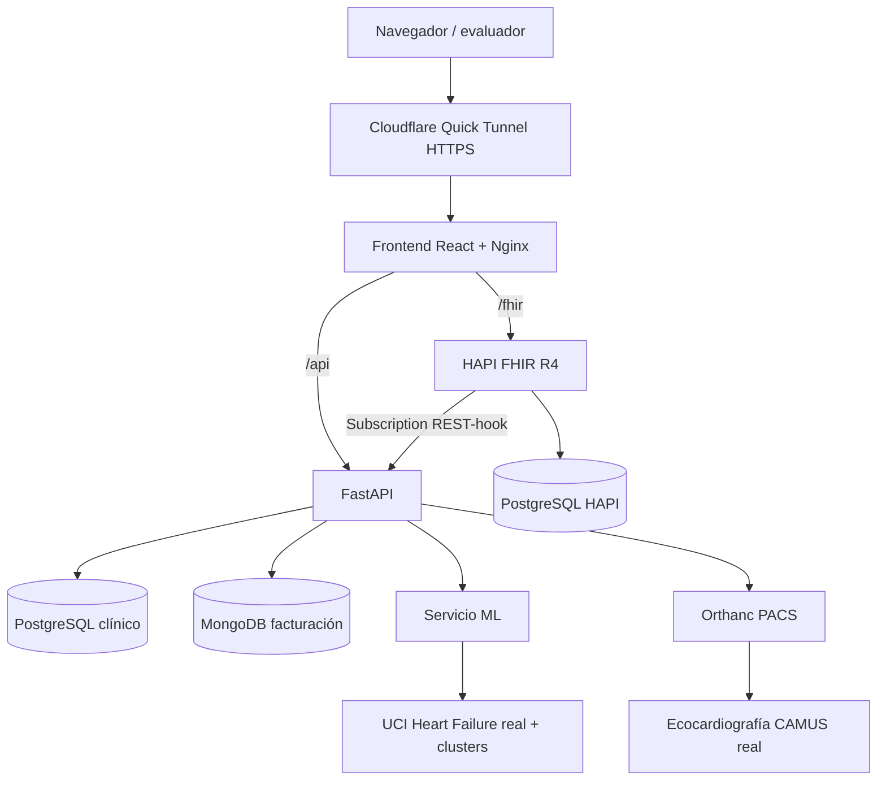
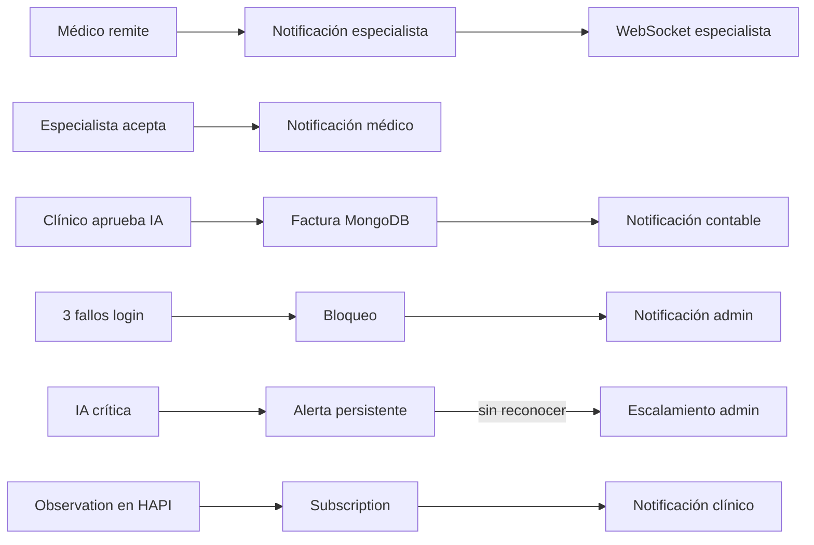

# Heart Failure Rural Monitoring — Corte 2

Sistema académico de Salud Digital orientado al seguimiento de **insuficiencia cardiaca**. La versión 2 conserva la base del Corte 1 (PostgreSQL, FastAPI, JWT, HAPI FHIR, soft delete, auditoría y frontend React) e incorpora PACS, dataset real, aprendizaje supervisado, clustering, MongoDB, remisiones y comportamiento reactivo en tiempo real.

> Proyecto docente. Los modelos, umbrales y asociaciones entre imágenes/datos no están validados para uso clínico real.

## Arquitectura de servicios



## Diagrama de eventos



## Servicios Docker

Un solo comando levanta:

- `app-db`: PostgreSQL clínico;
- `hapi-db` + `hapi-fhir`: servidor FHIR R4;
- `mongo`: facturación no relacional;
- `orthanc`: PACS;
- `ml`: modelo supervisado + clustering;
- `api`: FastAPI;
- `frontend`: React compilado y servido por Nginx;
- `cloudflared`: publicación HTTPS del sistema completo.

## Puesta en marcha

### 1. Preparar variables

```powershell
Copy-Item .env.example .env
```

Cambie como mínimo `JWT_SECRET_KEY` y `FHIR_HOOK_SECRET`. `.env` está ignorado por Git y no debe subirse.

### 2. Levantar todo

```powershell
docker compose up --build -d
```

Verifique:

```powershell
docker compose ps
```

Frontend local: `http://localhost:5173`

Swagger local: `http://localhost:8000/docs`

FHIR local: `http://localhost:8080/fhir/metadata`

### 3. Crear los cinco usuarios académicos y el paciente demo

```powershell
python scripts/seed_demo_api.py
```

Credenciales de prueba:

| Rol | Usuario | Contraseña |
|---|---|---|
| admin | `admin.demo` | `AdminDemo2026!` |
| medico | `medico.demo` | `MedicoDemo2026!` |
| especialista | `especialista.demo` | `EspecialistaDemo2026!` |
| paciente | `paciente.demo` | `PacienteDemo2026!` |
| contable | `contable.demo` | `ContableDemo2026!` |

Son credenciales exclusivamente de demostración y coinciden con `tester.yaml`.

### 4. Cargar al menos una imagen CAMUS real

CAMUS no se redistribuye dentro del ZIP. Descárguelo desde una fuente autorizada y ejecute:

```powershell
python scripts/import_camus_folder.py --patient-id DEMO-HF-001 --folder <CARPETA_CAMUS>
```

El backend convierte PNG/JPG a DICOM Secondary Capture cuando hace falta, lo almacena en Orthanc y registra que la relación con el paciente de la aplicación es **académica**.

### 5. Obtener URL pública

```powershell
docker compose logs cloudflared | Select-String "trycloudflare"
```

La URL cambia cada vez que se reinicia el contenedor `cloudflared`; después de obtenerla, actualizar `base_url` y `fhir_base_url` en `tester.yaml`.

Un único hostname sirve:

```text
https://xxxxx.trycloudflare.com/             frontend
https://xxxxx.trycloudflare.com/api/docs     Swagger
https://xxxxx.trycloudflare.com/fhir/metadata HAPI FHIR
```


### 6. Verificación automática R01–R21

```powershell
python scripts/e2e_check.py --base http://localhost:5173/api --fhir http://localhost:5173/fhir
# contra la URL pública:
python scripts/e2e_check.py --base https://xxxxx.trycloudflare.com/api --fhir https://xxxxx.trycloudflare.com/fhir
```

Requiere `pip install httpx websockets`. El script reproduce los chequeos del tester (roles, bloqueo, seguridad, canal en vivo, IA con aprobación, factura automática, remisión, alertas, FHIR reactivo, auditoría y rate limit) e imprime `OK`/`FALLA` por requisito. Crea un usuario auxiliar `bloqueo.demo` para R02.

## Interoperabilidad FHIR reactiva

El mecanismo estándar sigue siendo una `Subscription` R4 tipo `rest-hook` creada automáticamente en HAPI. Como respaldo determinista para la prueba externa de R21, el `POST /fhir/Observation` público entra por Nginx a un gateway de FastAPI: FastAPI reenvía la Observation a HAPI y dispara el mismo reactor de notificación **sin polling**. El resto de rutas `/fhir/*` van directamente a HAPI. La deduplicación por id del recurso evita notificar dos veces si el rest-hook también llega.

## Seguridad

- JWT Bearer para rutas de datos;
- Argon2 para contraseñas;
- bloqueo al tercer intento fallido y desbloqueo exclusivo de admin;
- RBAC y aislamiento por paciente;
- CORS explícito, no wildcard;
- `X-Content-Type-Options` y `X-Frame-Options`;
- rate limiting en FastAPI y Nginx;
- webhook FHIR protegido mediante secreto interno enviado por la Subscription;
- datos personales no se envían al servicio ML;
- `.env` excluido del repositorio.

## Datasets

- **Imagen:** CAMUS, ecocardiografía 2D real. Se carga a Orthanc y se vincula académicamente a un paciente creado en la aplicación.
- **Tabular:** UCI Heart Failure Clinical Records. El repositorio incluye 187 registros reales de la cohorte; el servicio ML crea aumento sintético únicamente dentro de clusters y marca el origen.

Detalles y licencias: `docs/DATASETS.md`.

## Documentación Corte 2

- `docs/CORTE2_REQUISITOS.md` — mapa R01–R22.
- `docs/DATASETS.md` — datasets y clustering.
- `docs/EVENTOS.md` — catálogo reactivo.
- `docs/CONTABILIDAD.md` — MongoDB.
- `docs/SEGURIDAD_IA.md` — minimización/seudonimización.
- `docs/MODELO_ML.md` — métricas, umbral crítico, clustering y análisis por subgrupo.
- `docs/MAPA_NORMATIVO.md` — correspondencia normativa académica.
- `docs/ROLES_Y_PERMISOS.md` — qué puede hacer cada rol.
- `docs/MAPEO_BD_FHIR.md` y `docs/ERD.md` — modelo de datos y su mapeo a FHIR R4.
- `tester.yaml` — contrato de rutas y usuarios; sustituir URL pública antes de entregar.

## Imágenes CAMUS (R06)

Las ecocardiografías CAMUS no se incluyen en el repositorio porque su licencia (CC BY-NC-SA 4.0) no permite redistribuirlas. Se descargan del portal oficial, se convierten con `scripts/camus_to_png.py` y se cargan al PACS con `scripts/import_camus_folder.py` (paso 4). El sistema evaluado tiene cargadas las 4 imágenes ED/ES (vistas 2CH y 4CH) del sujeto `patient0001`.


## Identificadores humanos en Swagger

Desde esta versión, el login continúa siendo **usuario + contraseña**, mientras
que las rutas de usuarios y pacientes aceptan el **número de identificación**
como referencia preferida. Los UUID permanecen como llaves técnicas internas.

Ejemplos:

```text
GET /users/1000000002
GET /patients/DEMO-HF-001
GET /patients/DEMO-HF-001/images
```

Los UUID y códigos `USR-*` / `PAT-*` continúan aceptándose para compatibilidad.
Ver `docs/IDENTIFICADORES_INTEROPERABILIDAD.md`.


### Si ya tienes una base del Corte 1 / versión anterior

Ejecuta las migraciones antes de levantar la versión nueva:

```powershell
.\scripts\apply_migration.ps1
```

La migración `004_human_identifiers_for_swagger.sql` agrega/restaura `document_type` y `document_number` en usuarios sin cambiar las llaves UUID internas. Los registros heredados reciben temporalmente un identificador `LEGACY-USR-*`; el script `seed_demo_api.py` corrige automáticamente las cuentas demo.