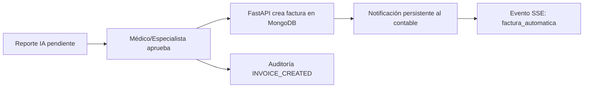

# Contabilidad en MongoDB

La facturación se guarda en MongoDB (`heart_failure_billing.invoices`), separada de la historia clínica relacional.

Cada documento contiene como mínimo:

```json
{
  "patient_id": "uuid",
  "servicio": "Análisis de IA - insuficiencia cardiaca",
  "valor": 85000,
  "fecha": "ISODate",
  "estado_pago": "PENDIENTE",
  "created_by": "uuid",
  "reporte_id": "uuid"
}
```

`reporte_id` aparece en facturas automáticas generadas al aprobar un reporte de IA. Solo `contable` y `admin` pueden listar/crear facturas manuales. Un médico no tiene acceso al módulo contable.

## Flujo automático



Endpoints:

- `POST /billing/invoices` — factura manual, contable/admin.
- `GET /billing/invoices` — listado, contable/admin.
- `POST /ai/reports/{id}/approve` — genera automáticamente la factura vinculada al reporte.
