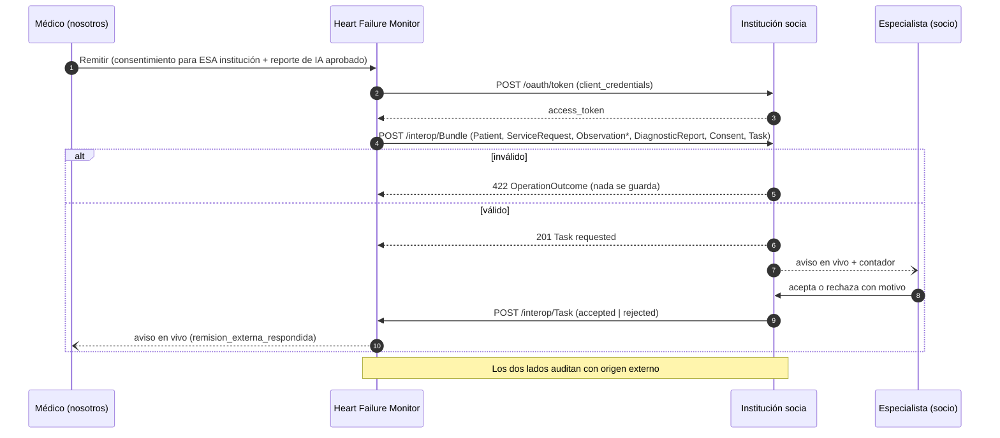

# Interoperabilidad entre instituciones

Heart Failure Monitor (UAO) · Proyecto final (R29 a R33)

Seguimos el **contrato común** del curso, el mismo que publicó Pulso (Hospital San Rafael): mismas rutas, mismo Bundle y mismo Task. Así, cualquier equipo que ya habla con Pulso habla con nosotros sin cambios. El ejemplo de Pulso (`docs/interop/pulso_bundle_remision_ejemplo.json`) entra tal cual y forma parte de la prueba.

`<base>` = nuestra URL pública + `/api`, por ejemplo `https://<tunel>.trycloudflare.com/api`. `GET <base>/interop/metadata` (sin autenticación) devuelve este contrato como `CapabilityStatement`.

## 1. El flujo



En sentido contrario es igual: el socio nos remite, nuestro especialista decide y el Task le vuelve solo.

## 2. Rutas de entrada para los socios

| Método y ruta | Para qué | Permiso (scope) | Respuestas |
|---|---|---|---|
| `GET /interop/metadata` | Qué aceptamos y cómo autenticarse (público, sin datos) | — | 200 `CapabilityStatement` |
| `POST /oauth/token` | Token de sistema (formulario o HTTP Basic) | — | 200, 400, 401 |
| `POST /interop/Bundle` | Nos remiten un paciente | `system/ServiceRequest.write` (alias `bundle:write`) | 201 Task, 400, 401, 403, 409, 413, 422 |
| `POST /interop/Task` | Responden una remisión que les enviamos | `system/Task.write` (alias `task:write`) | 200 Task, 400, 401, 403, 404, 409, 422 |
| `GET /interop/Task/{id}` | Consultan el estado de una remisión que nos enviaron | `system/ServiceRequest.write` | 200 Task, 401, 404 |

**Credencial de la institución** (una de las dos):

- `Authorization: Bearer <access_token>`, obtenido con `grant_type=client_credentials&client_id=…&client_secret=…[&scope=…]`. El token dura 10 minutos y la respuesta lleva `Cache-Control: no-store`.
- `X-API-Key: <client_id>.<client_secret>`.

Cabeceras opcionales:

- `x-nonce`: recomendada. Lleva un valor nuevo en cada envío, de 16 a 128 caracteres `A-Z a-z 0-9 _ -` (un UUID sirve). Si se repite responde 409; si el formato es inválido, 400.
- Firma HMAC, solo si se acuerda con la institución: `X-Timestamp` (segundos Unix, ±300 s), `X-Nonce` y `X-Signature = v1=` + hex(HMAC-SHA256(secreto_firma, cadena)). La cadena es `v1\n<ts>\n<nonce>\nPOST\n<ruta sin /api>\n<sha256 hex del cuerpo exacto>`.

Las credenciales de sistema **solo** abren estas rutas: en la API clínica (`/patients`, `/referrals`…) un token de sistema da 401, y un token de usuario da 401 aquí (R31). Esto se logra porque el token de sistema se firma con una clave distinta, derivada de la principal, y lleva `aud`, `iss`, `type=interop` y `exp` obligatorios.

## 3. El Bundle que aceptamos

Puede ser de tipo `transaction`, `collection`, `batch`, `message` o `document`. Las entradas pueden ir con `POST` o `PUT` y las referencias pueden ser `Tipo/id` o `urn:uuid:`.

| Recurso | Cantidad | Reglas |
|---|---|---|
| `Patient` | exactamente 1 | Basta un identificador: documento **con su tipo** (`type.coding.code` CC, TI, CE, PA, RC…), id federado o `id`. `birthDate` en `AAAA`, `AAAA-MM` o `AAAA-MM-DD`; `gender` es opcional. Teléfono, correo y dirección **se descartan**. |
| `ServiceRequest` | exactamente 1 | `status: active`; `intent` order, original-order, plan, proposal o directive; `code` SNOMED (p. ej. `3457005`) o al menos `text`; `subject` apuntando al Patient; motivo en `reasonCode[].text` o `note`, de ≥5 caracteres; `priority` routine, urgent, asap o stat; `id` o `identifier` obligatorio (evita duplicados). La especialidad va en `performerType`. |
| `Observation` | 0 o más | Código LOINC; `status` final, amended, corrected o preliminary; valor en `valueQuantity` (numérico; si trae `system`, debe ser UCUM), `valueString`, `valueCodeableConcept`, `valueBoolean` o `component`. |
| `DiagnosticReport` | 0 o 1 | Solo el reporte de IA **aprobado**: `final`, `amended` o `corrected`. Uno `preliminary` da 422. |
| `Consent` | 0 o 1 | `status: active`; se guarda como evidencia. |
| `Task` | 0 o 1 | `status: requested`. Guardamos su `id` y con él les respondemos. |

Todo se procesa en **una transacción**. Pasos:

1. Se identifica al paciente: primero por id federado, luego por documento. Si no existe, se registra con lo mínimo.
2. Se asigna al especialista activo con menos remisiones pendientes.
3. Se guardan las Observation.
4. Se audita y se avisa en vivo al especialista. La remisión aparece en su bandeja, en su contador y en el panel **Remisiones entre instituciones**.

Respondemos `201` con un `Task` `requested`, con `Location: /interop/Task/rem-<n>` y `X-Remision-Externa: rem-<n>`. El Task conserva **sus** ids: `id` = su Task, y `focus`/`basedOn` = su ServiceRequest.

Errores: siempre un `OperationOutcome` con un `issue` por problema.

- **400:** el cuerpo no es JSON o el nonce es inválido.
- **401:** falta la credencial, es inválida o vencida, la firma no cuadra o la institución está desactivada.
- **403:** falta el scope.
- **409:** remisión o nonce repetido, o no hay especialistas.
- **413:** el cuerpo pasa de 1 MB.
- **422:** el contrato no se cumple.

## 4. El Task de respuesta

**Lo que enviamos** cuando nuestro especialista decide va a su ruta de Task, con su credencial y `X-Nonce`/`X-Timestamp` nuevos:

```json
{"resourceType": "Task", "id": "<su Task>", "status": "accepted", "intent": "order", "priority": "urgent",
 "identifier": [{"system": "https://hfmonitor.uao.edu.co/fhir/identifier/remision", "value": "<nuestro n>"}],
 "focus": {"reference": "ServiceRequest/<su id>", "identifier": {"system": "…", "value": "…"}, "type": "ServiceRequest"},
 "basedOn": [{"reference": "ServiceRequest/<su id>", "type": "ServiceRequest"}],
 "for": {"reference": "Patient/<su id>"}, "statusReason": {"text": "La valoramos mañana a las 8:00"},
 "businessStatus": {"text": "Aceptada: el especialista atenderá al paciente"},
 "owner": {"display": "Heart Failure Monitor (UAO)"}, "lastModified": "…"}
```

**Lo que aceptamos** en `POST /interop/Task`:

- `status`: accepted, rejected, in-progress, completed, cancelled o failed.
- Cómo señalar la remisión: `focus`/`basedOn` a `ServiceRequest/rem-<n>` (o su `identifier`), o `id` = `rem-<n>`.
- El motivo, en `statusReason.text`, `businessStatus.text` o `note`.

Solo valen respuestas a remisiones que **les** enviamos (si no, 404). Un reintento idéntico devuelve 200 sin repetir el aviso.

## 5. Lo que enviamos (R32: consentimiento y minimización)

- **Consentimiento:** sin un `Consent` vigente del paciente **para esa institución**, `POST /remisiones/externas` responde 409 y no sale nada. Lo registra el médico o el paciente en la ficha, y se puede revocar. Se consulta en FHIR con `GET /patients/{id}/consentimientos?formato=fhir`.
- **Reporte de IA:** solo uno **aprobado**. Si el paciente no tiene, o el elegido está pendiente o rechazado, responde 409.
- **Patient:** documento con su tipo, nombre, sexo, fecha de nacimiento e id federado. **Nunca** teléfono, correo, dirección ni municipio o vereda.
- **Observation (LOINC + UCUM):** las que elija el médico. Si no elige, va el último valor de cada examen de los últimos 30 días, más las variables de laboratorio con que se calculó el reporte aprobado (creatinina 2160-0, sodio 2951-2, FEVI 10230-1, CPK 2157-6, plaquetas 777-3). Máximo 20.
- **IDs estables:** todo va con `PUT`: `Patient/pac-<id federado>`, `ServiceRequest/rem-<n>`, `Task/rem-<n>`, `Consent/con-<n>` y `DiagnosticReport/rep-<id>`.
- **Si el socio no responde**, la remisión queda guardada con `estado_envio = fallida`, el código y el cuerpo devueltos, y el médico la **reenvía** con un clic. El socio deduplica por el `identifier` del ServiceRequest.

**Id federado:** `HMAC-SHA256(INTEROP_SECRETO_FEDERADO, "TIPO|documento")[:32]`, con el documento sin puntos, espacios ni guiones. Con el secreto de la clase, `CC|1144123456` da `fa0d2121aa10d0c2bb7a5acd8b596f2f`, igual que Pulso. Por eso un paciente que ya existe en las dos instituciones se reconoce sin depender del formato del documento.

## 6. Cómo conectarse con cualquier equipo

Todo se hace desde **Administración → Instituciones socias** en la aplicación, o con el script dentro del contenedor:

1. **Ellos → nosotros.** Creamos su institución y les entregamos la credencial **por un canal privado**. Se muestra una sola vez; en la base solo queda su hash Argon2id.
   ```powershell
   docker compose exec api python scripts/interop_cliente.py socio-crear pulso "Pulso · Hospital San Rafael" https://SU-TUNEL.trycloudflare.com/api --sin-firma
   ```
2. **Nosotros → ellos.** Cargamos la credencial que ellos nos dieron. Va en variables de entorno, nunca en la línea de comandos, y queda cifrada con AES-256-GCM.
   ```powershell
   docker compose exec -e SOCIO_CREDENCIAL_ID=cli_xxx -e SOCIO_CREDENCIAL_SECRETO=yyy api python scripts/interop_cliente.py socio-credenciales pulso --auth oauth2
   ```
   Otras formas: `--auth api_key` (en SOCIO_CREDENCIAL_SECRETO va la API key completa), `--auth bearer` o `--auth ninguno`. Si sus rutas son distintas: `--ruta-bundle`, `--ruta-task`, `--ruta-token`, `--cabecera`. Si acordaron firma: `-e SOCIO_FIRMA_SECRETO=…`.
3. **Su túnel cambió:** `socio-url pulso https://NUEVO/api`, o editar la URL en la pantalla. No hay que redesplegar.
4. **Ver el estado:** `socio-listar`. **Cortar el acceso:** `socio-desactivar pulso`; sus tokens vivos dejan de servir de inmediato.
5. **Ensayo sin depender de nadie:** `espejo` (o el botón *Crear / renovar espejo*) nos registra como socio de nosotros mismos. Una remisión a "Espejo" hace el viaje completo por la puerta real.

## 7. Cómo se probó

`python scripts/test_interop.py [<base>]` crea dos instituciones que apuntan a nosotros mismos (una con firma) y verifica **53 puntos**: OAuth2 (`invalid_client` idéntico, `invalid_scope`, Basic), separación de tokens (de usuario vs. de sistema), 400/403/409/413/422 sin datos a medias, el Bundle de Pulso tal cual, el consentimiento (sin él, 409; revocado, 409), el viaje completo con rechazo y aceptación con motivo, reintento idempotente del Task, firma (alterada, vieja, replay), desactivación con token vigente y auditoría. Resultado local: 53/53.

## 8. STRIDE de esta puerta

| Amenaza | Cómo se materializaría | Control |
|---|---|---|
| **S**poofing | Hacerse pasar por una institución | Credencial por institución (Argon2id); `invalid_client` idéntico y con el mismo costo para cliente inexistente; firma HMAC opcional con secreto distinto |
| **T**ampering | Cambiar el Bundle en tránsito | HTTPS del túnel; si hay firma, el hash del cuerpo va firmado; validación completa del recurso antes de tocar la base |
| **R**epudiation | «Nosotros no enviamos esa remisión» | Auditoría de cada token emitido o rechazado, recepción, rechazo (IP, client_id, problemas), envío, respuesta y consulta, con `origen: externo` |
| **I**nformation disclosure | Datos de contacto o de más hacia el socio | Consentimiento por institución (Ley 1581); Patient sin teléfono, correo ni dirección; solo el reporte aprobado; los secretos nunca se auditan ni se listan |
| **D**enial of service | Inundar `/oauth/token` o `/interop/Bundle` | `limit_req` en nginx (el token, como un login); 1 MB por Bundle; máximo 200 entradas; nonces purgados a las 24 h |
| **E**levation of privilege | Usar el token del socio en la API clínica, o uno de usuario aquí | Clave de firma distinta + `aud`/`iss`/`type`; scopes por ruta; un token de sistema nunca es un usuario |
| (Replay) | Reenviar un mensaje grabado | `x-nonce` de un solo uso por institución (409), ventana de ±300 s si hay firma, y deduplicación por el identifier del ServiceRequest |

## 9. Limitaciones conocidas

- El token y la firma son secretos compartidos (HS256/HMAC): quien comprometa nuestro servidor podría emitir tokens. Con RS256 o mTLS solo se guardarían claves públicas.
- Si no se define `INTEROP_CLAVE_CIFRADO`, la clave de cifrado se deriva de `JWT_SECRET_KEY`. Si esa clave cambia, hay que volver a cargar las credenciales de salida de los socios.
- El id federado es un seudónimo: quien tenga el secreto federado puede calcularlo para cualquier documento.
- La asignación de especialista no distingue especialidades: todos nuestros especialistas son de cardiología. La especialidad pedida queda registrada en la remisión.
